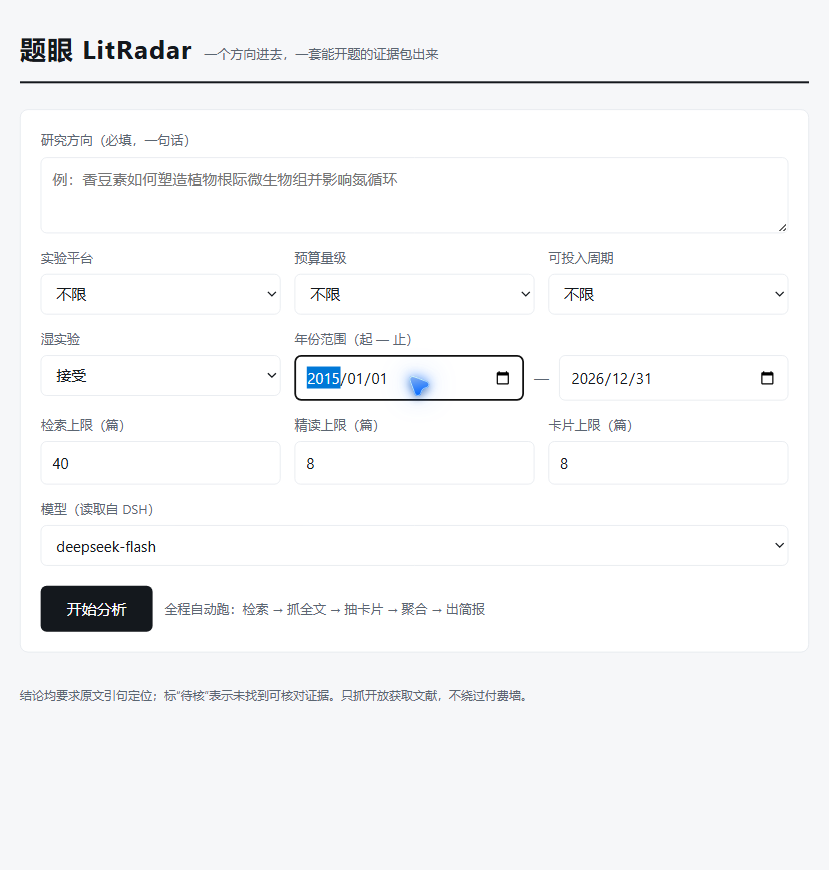
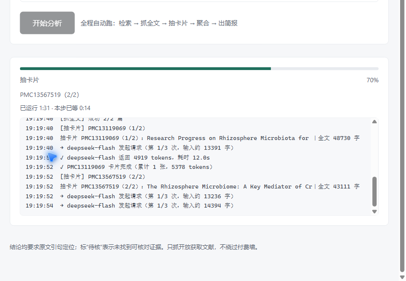

# LitRadar · 题眼

> 从一个研究方向，到一套能开题的证据包。

输入一句话方向（可选平台、预算、周期），输出六件东西：领域全景、证据矩阵、单篇卡片、图表复刻清单、方向候选、开题卡。

**当前状态：`v0.7.0`。** 整条流水线可跑：学科判定 → 多源检索（Europe PMC / PubMed / OpenAlex / Web of Science / Scopus，按需勾选）→ 相关性闸门 → 抓 OA 全文/图注 → 抽结构化卡片 → 引文校验 → 跨文献聚合 → 开题报告（九节骨架 + 附录）→ 证据简报 → 本地 Web 界面，并已挂进 DeepSeek Harness（DSH）左侧栏。模型由 DSH 内部模型目录自动发现，Key 复用 DSH 凭据，默认 `deepseek-flash`。

一次真实运行（忆阻器类脑神经网络，`v0.6.0`）：候选 20 篇 → 同域 20 篇 → 全文 4 篇 → 卡片 3 张（PSPP 口径）→ 聚合 3 张 → 45,482 tokens → 45.8 KB 六件套简报，农业类干扰词出现 0 次。

一次真实运行（黄花棘豆内生真菌抗锈病）：检索 13 篇 → 抓取全文 10 篇 → 生成 8 张卡片 → 聚合 7 张 → 51,646 tokens → 52 KB 六件套简报。没有一张卡片编造引文：命中不到原文的字段一律降级为「待核」，不进结论。

## 长什么样

| 面板表单 | 实时进度 |
|---|---|
|  |  |


## 为什么叫「题眼」

「题眼」是语文里的说法：一篇文章最要紧的那一句。文献也一样——作判断的依据不在摘要的套话里，而在支撑结论的那一句原文。LitRadar 要做的就是把这句「眼」找出来，再把它的位置钉死；Radar 指扫描与定位。

## 它解决什么

读文献最耗时的不是找，而是判断：

- 这个领域哪些已经做透了，哪些还在争？
- 每篇文章到底怎么设计的，n 是多少，测了什么？
- 这张图我能不能复刻，需要什么数据？
- 我现在的条件，能做哪几个方向？

LitRadar 把这几件事做成一条流水线，每条结论都要求带证据定位（页码/图号/原文引句），没有定位的进“待核”，不混进结论。

## 换个学科也能用（v0.6.0）

插件不再是“农学专用”。同一个方向输入进来，先判学科，再换口径、换卡片字段、换过滤词：

| 学科 | 归纳范式 | 卡片字段 | 挡掉什么 |
|---|---|---|---|
| 材料与器件 | PSPP（制备—结构—性质—性能） | 体系与结构 / 工艺参数 / 表征检测 / 性能指标 | 盆栽、田间、小鼠、根际等生物实验词 |
| 植物—微生物 / 农学 | PICO | 群体 / 干预 / 对照 / 结局 | 器件、薄膜、退火等材料词 |
| 生物医学 | PICO | 人群 / 干预 / 对照 / 结局 | 与方向无关的物种与体外体系 |
| 通用 | 四要素 | 对象 / 方法 / 对照 / 结果 | 不启用闸门，全部放行 |

检索回来先过一道**相关性闸门**：标题与摘要里同时数“方向主题词命中”“学科词命中”“干扰词命中”，加权打分低于阈值的直接挡掉，并在简报开头写一份**检索体检**——候选多少、同域多少、挡掉多少、为什么挡、期刊与年份分布。若一篇都没留下，简报会红字警告“本次没有同域文献，后面的归纳不可用”，而不是硬凑结论。

另外两处防串味：本轮只抓本轮候选的全文、只聚合本轮生成的卡片，历史库里别的方向的卡片不会被拉进来；Europe PMC 全文接口临时故障时自动退到 NCBI efetch，同一份 JATS 照样解析。

**已知边界**：WOS / Scopus 没有公开的“账号密码登录”，只认机构订阅的 API Key；没有 Key 时这两家不出结果，不是插件漏检。OECD 子类用于定口径（闸门词表与卡片语义），不做硬过滤——这些库本身没有该字段，硬筛会把正常文献筛没。全文仍只有 PMC 系能给，WOS/Scopus/OpenAlex 命中的条目只出摘要级卡片并标注。

## 检索源：按权威度自己勾（v0.7.0）

| 源 | 定位 | 要什么 | 全文 |
|---|---|---|---|
| Web of Science | 全学科引文索引，材料/工程覆盖最好 | 机构订阅的 API Key（Clarivate 开发者门户） | 无，仅题录与引文 |
| Scopus | 全学科摘要与引文，Elsevier 口径 | 机构订阅的 API Key（可加机构 Token） | 无，仅题录 |
| PubMed | 生物医学权威文摘库 | 免费，建议填邮箱提高额度 | 无，PMC 那部分才给全文 |
| Europe PMC | 生命科学 + 开放获取全文 | 免费 | 有，含图注 |
| OpenAlex | 全学科开放元数据，补材料/工程召回 | 免费，建议填邮箱 | 部分有 OA 链接 |

界面里勾选即用；WOS / Scopus 点“配置”填 Key，Key 存本机 `LITRADAR_HOME/credentials.json`（不进仓库、不回显、不写日志）。填了“有效期至”就按日期自动停用，源状态变成“已过期，需重新配置”，运行前直接跳过，不会拿过期 Key 反复撞 401。没配 Key 的源不会拖垮整轮：其它源照常检索，日志里写明哪家失败、为什么。

## 交付：开题报告，不是卡片墙

`开题报告.md` / `开题报告.docx` 按国内通行骨架排：

1. 立项依据（背景 → 国内外现状 → 不足）
2. 研究目标（总目标 + 分目标）
3. 研究内容（3 块，逻辑递进）
4. 研究方案与技术路线（阶段表 + 复刻要点）
5. 创新点（对着 gap 写）
6. 可行性分析（课题组五维自评 + 条件约束）
7. 预期成果
8. 进度安排（按可投入周期倒排）
9. 参考文献

附录 A 证据矩阵、附录 B 检索体检、附录 C 单篇卡片与引文定位。卡片和证据矩阵是**附录**，正文只写能从证据里推出来的话；推不出来的标“待定/待申请人补充”。

## 课题组条件：五维自评

界面里按 1–5 级填五项：PI 学术资本（权重 0.30）、平台与条件（0.20）、前期积累（0.20）、团队梯队（0.15）、经费与项目（0.15），每项都有锚点说明。综合分 ≥4.2 记“强”、≥3.0 记“中”、其余“弱”，短板会写进报告第六节并给出补法（合作、共享平台、缩小目标）。数据只存在本机，插件不编单位信息。

## 目录约定

- 仓库只放代码、测试与文档，不放运行产物。
- 运行产物（`runs/`、`fulltext/`、`data/`）走 `LITRADAR_HOME`，默认 `~/.litradar`，与仓库分开。
- 需要给人看的成品（Word 开题报告、PPT、产品简介）放到指定的工作目录，仓库里不留副本。

## 安装

### 方式一：装成 DSH 插件（推荐）

到 [Releases](../../releases) 下载 `litradar-dsh-plugin-0.7.0.tgz`、`litradar-engine.zip`、`install.ps1`、`uninstall.ps1`，放同一目录，在 PowerShell 里：

```powershell
.\install.ps1 -Profile both      # web + 桌面版都装
.\uninstall.ps1 -Profile both    # 卸载
```

细节见 [`packaging/安装与卸载.md`](packaging/安装与卸载.md)。装好后 DSH 左侧栏「新会话」下面有「题眼 LitRadar」。

### 方式二：只在本机跑引擎（开发用）

需要 Python 3.11+，运行时不装额外依赖（PyYAML 用于读 DSH 配置）。

```powershell
.\litradar.cmd run --direction "香豆素如何塑造植物根际微生物组" --limit 20
.\litradar.cmd serve --port 8899     # 浏览器开 http://127.0.0.1:8899
```

## 用法

```bash
# 一条命令跑完整流水线：规划检索式 → 检索 → 抓全文 → 抽卡片 → 聚合 → 写简报
litradar run --direction "香豆素如何塑造植物根际微生物组" --limit 20 --cards 8

# 产物在 $LITRADAR_HOME/runs/<时间戳>/：report.md、papers.csv、summary.json

# 直接检索
litradar search --query "coumarin AND rhizosphere" --limit 60

# 用 PICO 四格拼检索式（同义词用 | 分隔）
litradar search \
  --pico population="Oxytropis ochrocephala|黄花棘豆" intervention="endophyte|内生真菌" \
  --years 2012-2026 --limit 60

# 看库内统计、导出
litradar stats
litradar export --out papers.csv

# 抓 OA 全文、图注与原图直链（默认抓 20 篇，可断点续跑）
litradar fetch --limit 20

# 只看某一篇抓到的图/表
litradar list-figures --pmcid PMC13529732
```

默认库在 `~/.litradar/data/litradar.db`，可用 `LITRADAR_HOME` 或 `--db` 改；全文 XML 存在 `$LITRADAR_HOME/fulltext/`。

Windows 下可直接用仓库根目录的 `litradar.cmd`（走系统 Python，不需要虚拟环境）：

```powershell
.\litradar.cmd fetch --limit 20
```

程序会自动读取系统代理（Clash 等），不需要额外设 `HTTPS_PROXY`。

## 数据与边界

- 只检索 **Europe PMC / PMC 开放获取** 英文文献；中文库没有公开接口，不在 MVP 范围。
- 卡片必须带证据定位；没有就标“待核”。
- 不生成不存在的文献、数据、图。
- 只给图表复刻方案，不生成成品图。
- 方向建议是候选，不是结论。

## 路线图

| 版本 | 内容 | 状态 |
| --- | --- | --- |
| v0.1.0 | Europe PMC 检索、PICO 检索式、SQLite、CSV 导出、测试与 CI | ✅ |
| v0.2.0 | OA 全文与图注抓取（JATS XML + `cloudpmc-urn` CDN）、引用句配对 | ✅ |
| v0.3.0 | 结构化卡片抽取、领域聚合、六件套简报、本地 Web 界面、DSH 插件 | ✅ |
| v0.4.0 | DSH 模型自动发现 + provider 路由、可分发包（tgz + 引擎 zip + 安装/卸载脚本） | ✅ |
| v0.5.0 | 进度面板实时活动日志与心跳、重试可见、输入框示例中性化、年份改起止日期选择器 | ✅ |
| 下一步 | 并行抓取、图表复刻清单自动生成、中文库接入 | 计划中 |

## 仓库结构

```
src/litradar/      # 引擎：检索、全文、卡片、聚合、简报、Web、模型发现
dsh-plugin/        # DSH 插件包（宿主侧 + 客户端侧）
packaging/         # install.ps1 / uninstall.ps1 / 安装与卸载.md
scripts/pack.ps1   # 打 dist/ 分发包
tests/             # 离线单测，不依赖网络
docs/              # 架构与插件说明
.github/workflows/ # CI 与 Release
```

## 参与

见 [CONTRIBUTING.md](CONTRIBUTING.md)。提交用语义化前缀：`feat:`、`fix:`、`docs:`、`test:`、`chore:`。

## License

MIT

