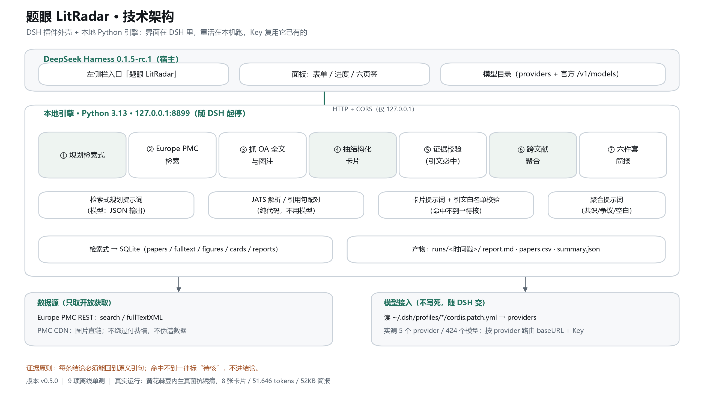

# LitRadar · 题眼

> 从一个研究方向，到一套能开题的证据包。

输入一句话方向（可选平台、预算、周期），输出六件东西：领域全景、证据矩阵、单篇卡片、图表复刻清单、方向候选、开题卡。

**当前状态：`v0.5.0`。** 整条流水线可跑：检索 → 抓 OA 全文/图注 → 抽结构化卡片 → 引文校验 → 跨文献聚合 → 六件套简报 → 本地 Web 界面，并已挂进 DeepSeek Harness（DSH）左侧栏。模型由 DSH 内部模型目录自动发现，Key 复用 DSH 凭据，本机实测可选 5 个 provider、424 个模型，默认 `deepseek-flash`。

一次真实运行（黄花棘豆内生真菌抗锈病）：检索 13 篇 → 抓取全文 10 篇 → 生成 8 张卡片 → 聚合 7 张 → 51,646 tokens → 52 KB 六件套简报。没有一张卡片编造引文：命中不到原文的字段一律降级为「待核」，不进结论。

## 长什么样

| 面板表单 | 实时进度 |
|---|---|
|  |  |



## 为什么叫「题眼」

「题眼」是语文里的说法：一篇文章最要紧的那一句。文献也一样——作判断的依据不在摘要的套话里，而在支撑结论的那一句原文。LitRadar 要做的就是把这句「眼」找出来，再把它的位置钉死；Radar 指扫描与定位。

## 它解决什么

读文献最耗时的不是找，而是判断：

- 这个领域哪些已经做透了，哪些还在争？
- 每篇文章到底怎么设计的，n 是多少，测了什么？
- 这张图我能不能复刻，需要什么数据？
- 我现在的条件，能做哪几个方向？

LitRadar 把这几件事做成一条流水线，每条结论都要求带证据定位（页码/图号/原文引句），没有定位的进“待核”，不混进结论。

## 安装

### 方式一：装成 DSH 插件（推荐）

到 [Releases](../../releases) 下载 `litradar-dsh-plugin-0.6.1.tgz`、`litradar-engine.zip`、`install.ps1`、`uninstall.ps1`，放同一目录，在 PowerShell 里：

```powershell
.\install.ps1 -Profile both      # web + 桌面版都装
.\uninstall.ps1 -Profile both    # 卸载
```

细节见 [`packaging/安装与卸载.md`](packaging/安装与卸载.md)。装好后 DSH 左侧栏「新会话」下面有「题眼 LitRadar」。

### 方式二：只在本机跑引擎（开发用）

需要 Python 3.11+，运行时不装额外依赖（PyYAML 用于读 DSH 配置）。

```powershell
.\litradar.cmd run --direction "香豆素如何塑造植物根际微生物组" --limit 20
.\litradar.cmd serve --port 8899     # 浏览器开 http://127.0.0.1:8899
```

## 用法

```bash
# 一条命令跑完整流水线：规划检索式 → 检索 → 抓全文 → 抽卡片 → 聚合 → 写简报
litradar run --direction "香豆素如何塑造植物根际微生物组" --limit 20 --cards 8

# 产物在 $LITRADAR_HOME/runs/<时间戳>/：report.md、papers.csv、summary.json

# 直接检索
litradar search --query "coumarin AND rhizosphere" --limit 60

# 用 PICO 四格拼检索式（同义词用 | 分隔）
litradar search \
  --pico population="Oxytropis ochrocephala|黄花棘豆" intervention="endophyte|内生真菌" \
  --years 2012-2026 --limit 60

# 看库内统计、导出
litradar stats
litradar export --out papers.csv

# 抓 OA 全文、图注与原图直链（默认抓 20 篇，可断点续跑）
litradar fetch --limit 20

# 只看某一篇抓到的图/表
litradar list-figures --pmcid PMC13529732
```

默认库在 `~/.litradar/data/litradar.db`，可用 `LITRADAR_HOME` 或 `--db` 改；全文 XML 存在 `$LITRADAR_HOME/fulltext/`。

Windows 下可直接用仓库根目录的 `litradar.cmd`（走系统 Python，不需要虚拟环境）：

```powershell
.\litradar.cmd fetch --limit 20
```

程序会自动读取系统代理（Clash 等），不需要额外设 `HTTPS_PROXY`。

## 数据与边界

- 只检索 **Europe PMC / PMC 开放获取** 英文文献；中文库没有公开接口，不在 MVP 范围。
- 卡片必须带证据定位；没有就标“待核”。
- 不生成不存在的文献、数据、图。
- 只给图表复刻方案，不生成成品图。
- 方向建议是候选，不是结论。

## 路线图

| 版本 | 内容 | 状态 |
| --- | --- | --- |
| v0.1.0 | Europe PMC 检索、PICO 检索式、SQLite、CSV 导出、测试与 CI | ✅ |
| v0.2.0 | OA 全文与图注抓取（JATS XML + `cloudpmc-urn` CDN）、引用句配对 | ✅ |
| v0.3.0 | 结构化卡片抽取、领域聚合、六件套简报、本地 Web 界面、DSH 插件 | ✅ |
| v0.4.0 | DSH 模型自动发现 + provider 路由、可分发包（tgz + 引擎 zip + 安装/卸载脚本） | ✅ |
| v0.5.0 | 进度面板实时活动日志与心跳、重试可见、输入框示例中性化、年份改起止日期选择器 | ✅ |
| 下一步 | 并行抓取、图表复刻清单自动生成、中文库接入 | 计划中 |

## 仓库结构

```
src/litradar/      # 引擎：检索、全文、卡片、聚合、简报、Web、模型发现
dsh-plugin/        # DSH 插件包（宿主侧 + 客户端侧）
packaging/         # install.ps1 / uninstall.ps1 / 安装与卸载.md
scripts/pack.ps1   # 打 dist/ 分发包
tests/             # 离线单测，不依赖网络
docs/              # 架构与插件说明
.github/workflows/ # CI 与 Release
```

## 参与

见 [CONTRIBUTING.md](CONTRIBUTING.md)。提交用语义化前缀：`feat:`、`fix:`、`docs:`、`test:`、`chore:`。

## License

MIT
